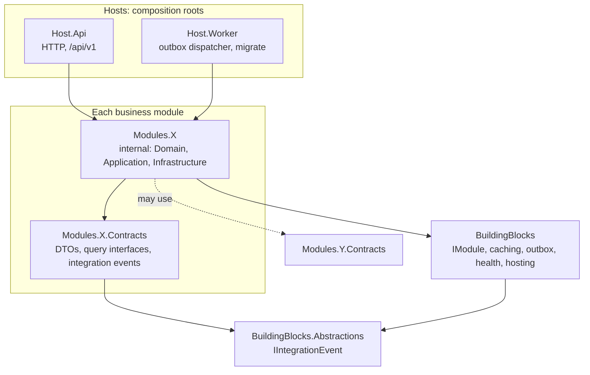
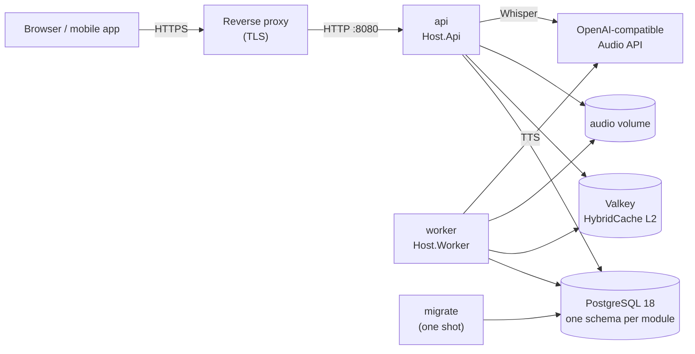
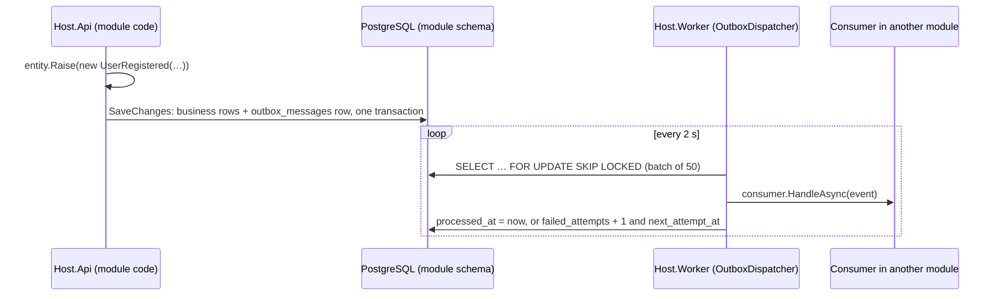

# English School

Backend for an 8-week (56-day) **A0 → A2 English course for Uzbek speakers**: daily grammar and
vocabulary, practice with tiered AI feedback, spaced-repetition review, pronunciation practice and a
daily-discipline loop.

It is a **.NET 10 modular monolith**: one deployable API, one background worker, and eight business
modules whose boundaries are enforced by tests rather than by convention.

| | |
|---|---|
| **Status** | Dev-weeks 11–12 done: system integration, an end-to-end student journey test, health checks and production deployment. Seven modules are implemented; AiGateway is scaffolded with its contracts. |
| **Runtime** | .NET 10 (SDK pinned in [`global.json`](global.json)), ASP.NET Core minimal APIs |
| **Data** | PostgreSQL 18 + pgvector, EF Core 10 (Npgsql), one schema per module |
| **Cache** | HybridCache: in-process L1, Valkey 8 (Redis protocol) as shared L2 |
| **Auth** | JWT access tokens + rotating refresh tokens; email/password or Telegram Login |
| **Deploy** | Multi-stage [`Dockerfile`](Dockerfile) (API and Worker images), [`docker-compose.yml`](docker-compose.yml) with a production profile |
| **Tests** | xUnit, ArchUnitNET, WebApplicationFactory, Testcontainers (PostgreSQL, Valkey); 368 tests |

---

## Contents

- [Architecture](#architecture)
- [Modules](#modules)
- [Getting started](#getting-started)
- [Running in production (Docker)](#running-in-production-docker)
- [Health checks and operations](#health-checks-and-operations)
- [Configuration](#configuration)
- [API](#api)
- [Authentication](#authentication)
- [Database and migrations](#database-and-migrations)
- [Testing](#testing)
- [Conventions](#conventions)
- [Troubleshooting](#troubleshooting)

---

## Architecture



**Hosts.** `Host.Api` and `Host.Worker` each list their modules in a `ModuleCatalog` and call
`IModule.AddServices`. Only the API calls `IModule.MapEndpoints`, under the `/api/v1` group. The Worker
runs the outbox dispatcher, which delivers every integration event, and the one-shot `migrate` command
used by deployments. Both composition roots are single methods (`ApiHost.Build`, `WorkerHost.CreateBuilder`)
that `Program` and the system tests share, so the tested hosts are the production hosts.

**Modules.** Every module is two projects:

- `Modules.X` holds the implementation. Its only public type is `XModule`; everything else is `internal`.
- `Modules.X.Contracts` is the module's public API: DTOs, query interfaces and integration events. It
  references only `BuildingBlocks.Abstractions`, never EF Core, ASP.NET Core or Npgsql.

**Rules** (enforced by [`tests/Architecture.Tests`](tests/Architecture.Tests), so a violation fails `dotnet test`):

1. A module never depends on another module's implementation, only on its `.Contracts`.
2. Contracts never depend on any module implementation.
3. Contracts reference no web or data frameworks.
4. A module's only public type is its `XModule` entry point (EF migrations excepted).
5. Building blocks know nothing about modules.
6. Every module's services resolve in a non-web host. Web-only services such as authorization belong
   in `Host.Api`.
7. Integration events are sealed records in `X.Contracts.Events`, never in module code, and every one
   round-trips through the outbox serializer.
8. A module whose entities raise events maps an outbox table, attaches the outbox interceptor and
   registers its outbox store. Only the Worker runs the dispatcher.
9. Every module database has a readiness check (`{module}-db`, tag `ready`) covering the connection
   and the module's migrations.
10. Committed `appsettings*.json` files hold no secrets: keys, tokens and passwords stay empty there.

**Data ownership.** Each module owns one PostgreSQL schema (`curriculum`, `identity`, …) with its own
`__ef_migrations_history` table. No module reads another module's tables. Cross-module reads go
through a Contracts interface (for example `ICurriculumQueries`).

### Runtime view



`migrate` applies every module's migrations and seeds the course, then exits. `api` and `worker` start
only after it succeeds and never migrate themselves. See [Running in production](#running-in-production-docker).

### Request pipeline

Every HTTP request passes, in order, through:

1. **Exception handler.** An unhandled exception becomes an RFC 9457 ProblemDetails response: 500 with an
   Uzbek message and a `traceId`, without exception text or stack trace (those go to the log). A malformed
   body becomes 400, and a request the client aborted is closed with 499.
2. **Status code pages.** Empty 4xx/5xx responses get a ProblemDetails body.
3. **CORS.** Only the origins in `Cors:AllowedOrigins` may call the API from a browser; with none
   configured, none may.
4. **Authentication.** JWT bearer, from the Identity module.
5. **Rate limiting.** One-minute sliding windows: credential endpoints per client IP, everything else per
   signed-in student (or IP). Rejections are 429 with `Retry-After`. Health endpoints are never limited.
6. **Authorization**, then the endpoint.

### Integration events and the outbox

Modules notify each other asynchronously through a **transactional outbox**, so an event is never lost
and never sent for a change that was rolled back.



1. **Raise.** An entity derives from `IntegrationEventSource` and calls `Raise(...)`.
2. **Store.** `OutboxInterceptor` turns those events into rows of the module's own `outbox_messages`
   table during `SaveChanges`, in the same transaction as the business data. A module opts in with
   `modelBuilder.AddOutboxMessages()`, `options.UseOutbox()` and `services.AddOutboxStore<TContext>()`.
3. **Deliver.** Only `Host.Worker` runs the dispatcher (`AddOutboxDispatcher`). It claims batches with
   `FOR UPDATE SKIP LOCKED`, so several Worker instances never deliver the same message twice at once.
4. **Consume.** A module subscribes with `services.AddIntegrationEventConsumer<TEvent, TConsumer>()`.
   Events nobody subscribes to are marked processed.
5. **Fail.** A failing consumer is retried with exponential backoff (2 s, 4 s, … capped at 5 min). After
   `MaxAttempts` (10) the message is parked, with `last_error` kept for inspection. A consumer's own
   timeout (`TaskCanceledException` from an `HttpClient`, for example) counts as an ordinary failure;
   it never stops the dispatcher.
6. **Stop.** On shutdown the dispatcher stops between messages: the deliveries finished in the current
   batch are committed, and the rest go back to the queue untouched.

Delivery is **at least once**: a consumer may see the same event twice, so it must be idempotent. Use
`EventId` (the outbox row's primary key) as the de-duplication key. The stored type name is the event's
full CLR name, so renaming or moving an event type strands its unprocessed rows. Treat event types as a
public contract.

| Event | Raised by | When | Consumed by |
|---|---|---|---|
| `UserRegistered` | Identity | sign-up (email or Telegram) | – |
| `AttemptEvaluated` | Practice | every graded attempt | Retention (enroll the day's cards), Speech (synthesize the day's clips), Analytics (attempts, accuracy) |
| `ErrorDetected` | Practice | each distinct known error type in an attempt | Analytics (error summary) |
| `DailyGatePassed` | Discipline | the morning gate is passed | Retention, Speech, Analytics (current day, vocabulary, streak) |
| `BlockCompleted` | Discipline | a focus block ends | – |
| `SessionEnded` | Discipline | a session completes or is abandoned | Analytics (focus time, completed days, streak) |
| `CardLapsed` | Retention | a card in Review is forgotten | – |
| `TranscriptReady` | Speech | a recording is transcribed and scored | – |

### Repository layout

```text
├── src
│   ├── BuildingBlocks.Abstractions/   # IIntegrationEvent, IntegrationEventSource, IIntegrationEventConsumer (framework-free)
│   ├── BuildingBlocks/                # IModule, Caching/ (HybridCache + Valkey), Outbox/, Health/, Hosting/, Security/
│   ├── Host.Api/                      # ApiHost (composition), Edge/ (CORS, rate limits), Health/, exception handler
│   ├── Host.Worker/                   # WorkerHost (composition, migrate command), outbox dispatcher
│   └── Modules/                       # Analytics, Curriculum, Discipline, Identity, Practice, Retention, Speech, AiGateway
│                                      # (each as X/ + X.Contracts/)
├── tests
│   ├── Architecture.Tests/            # module boundaries, host composition, events, outbox wiring, health, secrets
│   ├── Modules.*.Tests/               # one per implemented module: unit tests + API tests on PostgreSQL
│   └── System.Tests/                  # both hosts end to end: journey, health, edge, migrate, shutdown
├── deploy/postgres/init/              # runs once on a fresh database (CREATE EXTENSION vector)
├── scripts/dev-secrets.sh             # copies .env values into .NET user-secrets
├── Dockerfile                         # multi-stage: targets api and worker
├── docker-compose.yml                 # infrastructure by default, the whole system with --profile app
├── Directory.Build.props              # net10.0, nullable, warnings as errors, analyzers
└── Directory.Packages.props           # central package versions
```

---

## Modules

| Module | Status | Responsibility | Contracts |
|---|---|---|---|
| **Curriculum** | Implemented | Course → week → day structure, grammar topics, vocabulary. Versioned, read-only content served from HybridCache. | `ICurriculumQueries` |
| **Identity** | Implemented | Sign-up and login (email + password, Telegram), JWT access tokens, rotating refresh tokens, lockout. | `UserRegistered` |
| **Discipline** | Implemented | Daily plan, morning review gate (≥ 80 %), study-session state machine, focus blocks; unlocks the day's lesson. | `DailyGatePassed`, `BlockCompleted`, `SessionEnded`, `DisciplinePolicies` |
| **Practice** | Implemented (core) | Day exercises (gap-fill, multiple choice, matching), 4-tier grading, attempts, repeated-error taxonomy. | `AttemptEvaluated`, `ErrorDetected` |
| **Retention** | Implemented (core) | Word and phrase flashcards created automatically from the course, scheduled with FSRS-5; the gate's review check. | `CardLapsed`, `IRetentionGateAssessment` |
| **Speech** | Implemented (core) | Reference pronunciation clips (TTS) for every course word and phrase; pronunciation scoring of recordings (Whisper + word alignment). | `TranscriptReady`, speech DTOs |
| **Analytics** | Implemented | Progress and weekly-report read models built from other modules' events. | `IProgressQueries` |
| AiGateway | Scaffolded | The single path to LLMs: LanguageTool, Claude, evaluation cache, cost budget. Practice's tiers 2–3 switch on once it is registered. | `IAiGateway` |

### Discipline: daily plan, gate and sessions

**Daily plan.** On the student's first request of a (UTC) day, Discipline creates that day's plan: the
next course day after the last completed one, or the same day again if it wasn't completed. A plan
tracks the gate result and four completion flags (curriculum, practice, focus, day).

**Morning review gate.** `POST /discipline/gate/submit` takes one answer for **every** flashcard due now
(through `IRetentionGateAssessment`). An answer is correct when it equals the card's Uzbek side, ignoring
case and Unicode form. The gate passes at **≥ 80 %**. A student with no due cards, such as a new student
on day 1, passes with 100 %. Passing:

- unlocks `GET /curriculum/days/{n}` for that day (policy `discipline:daily-lesson-access`; before that, 403);
- raises `DailyGatePassed`, from which Retention enrolls the day's cards, Speech makes the day's clips and
  Analytics records the day.

A failed gate can be retried; passing is recorded once.

**Study sessions** follow a strict state machine; any other transition is rejected (409 from the API):

```text
Created → MorningGate → Active → FocusBlock → Completed
                 (any non-terminal state) → Abandoned
```

A session waits in `MorningGate` until the gate is passed, then becomes `Active`. Completing it records one
focus block (`BlockCompleted`) with its duration and distractions, ends the session (`SessionEnded`) and
marks the plan's focus as done.

**Known gap.** Nothing marks a plan's curriculum and practice as completed yet, so a plan's day never
completes and the next day's plan repeats the same course day. Closing this needs a product decision on
what completes a lesson and a practice set (for example, consuming `AttemptEvaluated` for the plan's day).

### Practice: exercises and grading

[`practice.v1.json`](src/Modules/Practice/Seed/practice.v1.json) holds 25 exercises for the week-1 lesson
days (1–6). Each one targets that day's grammar topic and "Diqqat" warnings. Matching pairs are copied
from the curriculum's own vocabulary for that day, and a test enforces this. Gap-fill items list their
accepted answers plus *known mistakes*, each with an error code and an Uzbek explanation of the rule.

Answers go through a **tiered pipeline**, cheapest first. The first tier that can decide wins, and the
attempt records which tier that was.

| Tier | What it does | Status |
|---|---|---|
| **0** Rules | Exact accepted answer, `AnswerPattern` regex, known mistake, chosen option, matching pairs. | ✅ |
| **1** Normalization | Letter case, spacing, curly or Uzbek `ʼ` apostrophes, contractions (`isn't` = `is not`), then typo detection: a missing apostrophe or 1–2 letter edits counts as *partially correct* with a `SPELLING` hint. Swaps of grammar words (`these`/`those`) are never treated as typos. | ✅ |
| **2–3** AiGateway | Gap-fill answers the rules couldn't decide are sent to `IAiGateway` (Haiku, then Opus). The tier switches itself on as soon as an `IAiGateway` is registered. | Scaffolded |

If no tier decides, the answer is marked incorrect and the correct answer is shown, without guessing an
error type. Known error codes (`BE_FORM`, `ART_WRONG`, `PLURAL_FORM`, …; see
[`ErrorCodes`](src/Modules/Practice/Domain/ErrorCodes.cs)) increment the student's `user_errors`
counter and are published as `ErrorDetected`.

### Retention: flashcards and FSRS

**Cards create themselves.** When a student practises a day (`AttemptEvaluated`) or unlocks one
(`DailyGatePassed`), Retention turns that day's vocabulary into flashcards, read through
`ICurriculumQueries.GetVocabularyAsync`. A card links to the Curriculum vocabulary item and keeps a copy
of its text. Enrollment is idempotent (unique per student and item), so redelivered events add nothing,
and new cards come due in course order.

**Scheduling is FSRS-5**, transcribed from the authors' reference implementation
([py-fsrs](https://github.com/open-spaced-repetition/py-fsrs) 3.1.0, 19 default weights). The tests pin
its exact outputs.

| Phase | Again (1) | Hard (2) | Good (3) | Easy (4) |
|---|---|---|---|---|
| **New** | Learning, 1 min | Learning, 5 min | Learning, 10 min | Review, *n* days |
| **Learning / Relearning** | stays, 5 min | stays, 10 min | Review, *n* days | Review, more days |
| **Review** | **lapse** → Relearning, 5 min | Review | Review | Review |

- **Intervals.** Within a day, steps adjust a short-term stability. Across days, the interval is when
  the chance of remembering drops to `DesiredRetention` (0.9), never above `MaximumIntervalDays` (365).
  Hard < Good < Easy always holds.
- **Lapses.** Only forgetting a card that was in Review counts as a lapse. It increments `lapses` and
  publishes `CardLapsed` through the outbox. Pressing Again on a card that was never learned is not a
  lapse.
- **Review log.** Every review is kept in `card_reviews` (rating, elapsed and scheduled days,
  stability, difficulty, retrievability) for future per-student optimization of the FSRS weights.
- **Double submits.** A double-submitted review of one card is rejected with 409 (row version), so it
  can't be counted twice.
- **Ratings.** These are 1–4; FSRS has no fifth grade.

### Speech: pronunciation clips and scoring

Both directions use one **OpenAI Audio API** client: `whisper-1` for transcription (`verbose_json` with
word timestamps, language fixed to `en`) and `tts-1` for synthesis (voice `alloy`, speed 0.9, MP3). Any
server that offers the same API works through `Speech:Provider:BaseUrl`. While `Speech:Provider:ApiKey`
is empty, scoring returns 503 and no clips are made.

**Clips.** When a student unlocks a day (`DailyGatePassed`) or practises it (`AttemptEvaluated`), the
Worker synthesizes that day's words and phrases. Each text is synthesized once for everybody: the
cache key is a SHA-256 of the text and the voice settings, so a redelivered event or a second student
adds nothing, and a new voice produces new clips. `GET /speech/days/{n}/audio` lists the day's
vocabulary in course order with clip IDs, which stay `null` until the Worker has made the clip.

**Scoring a recording** (`POST /speech/assess`, multipart `audio` + `targetText`):

1. The format comes from the file's first bytes (WebM, MP4/M4A, WAV, MP3, OGG, FLAC), never from the
   client's `Content-Type`. There is also a size limit and a per-student limit per 24 hours.
2. Whisper transcribes the recording. If the provider fails, nothing is stored.
3. Target text and transcript are normalized: case, punctuation, apostrophe variants, contractions
   (`I'm` = `I am`), numbers (`25` = `twenty-five`), accents (`café`) and a few spelling variants
   (`okay` = `ok`).
4. The two word sequences are aligned by a weighted Levenshtein alignment. Substituting a word costs
   1 − similarity; a missing or extra word costs 1. **Similarity** is the mean of the spelling
   similarity and the similarity of a *phonetic key*. The key follows the course's day-1 reading rules
   (`th` → θ, `sh` → ʃ, `ch`/`tch` → ʧ, `ph` → f, `ck` → k, `qu` → kw, soft `c`, magic `e`) and collapses
   vowels, so `think`/`sink` differ by one sound while `their`/`there` share a key.
5. The recording is stored, and the assessment plus `TranscriptReady` are saved in one transaction.
   If that save fails, the stored file is deleted.

| Word status | Rule | Credit |
|---|---|---|
| **Correct** | same word after normalization | 1 |
| **Close** | similarity ≥ 0.75, or the same phonetic key (homophone) | similarity |
| **Mispronounced** | similarity ≥ 0.45: a different but similar word was heard | similarity × 0.5 |
| **Missing** | not heard, or replaced by an unrelated word | 0 |
| **Extra** | heard but not in the text | counts as ½ word in the denominator |

- **Accuracy** = credit ÷ (target words + ½ × extra words). **Completeness** = share of target words
  that weren't missing.
- **Fluency** (from three target words up, when word timestamps exist) = 100 × (1 − pause time ÷ speech
  time) × min(1, words per minute ÷ 70). A pause is a gap of at least 0.5 s.
- **Overall** = 0.8 × accuracy + 0.2 × fluency, or just accuracy when fluency isn't measured.
- **Verdict:** `Correct` needs an overall score of at least 90 *and* every word Correct or Close.
  `PartiallyCorrect` needs at least 60; anything lower is `Incorrect`.
- **Feedback codes** with Uzbek hints cover typical errors of Uzbek speakers: `TH_SOUND` (think → sink,
  three → tree), `W_V_SOUND` (wine ↔ vine), `FINAL_CONSONANT` (cats → cat), plus `WRONG_WORD`,
  `MISSING_WORD` and `EXTRA_WORD`.

**Limits of this approach.** The score is built from what Whisper *heard*, not from phonemes. Vowel
quality (`ship`/`sheep`) and homophones can't be told apart, and Whisper's language model sometimes
repairs a weak pronunciation into the right word. Phoneme-level scoring (forced alignment, goodness of
pronunciation) would need a different provider.

**Storage.** Audio goes through `IAudioStorage`, with S3-style keys: `tts/{cacheKey}.mp3` and
`recordings/{user}/{id}.{ext}`. Today that is a local folder (`Speech:StoragePath`): `.data/audio` at the
repository root for both hosts in Development, and the shared `audio` volume (`/data/audio`) in the
containers. Several API or Worker hosts need a shared volume, or an S3 implementation of the interface.
**Recordings are personal data:** only their owner can fetch them, and no retention period is enforced
yet.

### Analytics: read models

Analytics owns no source data. It builds read models from other modules' events, in the Worker:

| Event | Effect |
|---|---|
| `AttemptEvaluated` | current day, total attempts, accuracy (mean attempt score) |
| `ErrorDetected` | per-student error summary: count, last correction, first and last seen |
| `DailyGatePassed` | current day, active vocabulary (+ the day's words and phrases), study streak |
| `SessionEnded` | weekly focus time, study streak; a session ended with `minimalDay: true` counts as a completed day (once per day) |

Each event is applied **exactly once**. Its `EventId` goes into `processed_events` in the same
transaction as the read-model change, so a redelivered event changes nothing. The streak counts
consecutive UTC days with a passed gate or an ended session and resets after a gap. Weekly reports run
Monday to Sunday (UTC). `GET /analytics/progress` and `/analytics/reports/weekly` read the models through
`IProgressQueries`.

**Curriculum content.** [`curriculum.v1.json`](src/Modules/Curriculum/Seed/curriculum.v1.json) is
embedded in the assembly: 56 days over 8 weeks, with 48 lessons, 6 review days and exams on day 28
(A1 gate) and day 56 (A2 gate). It holds 1,117 words and 235 phrases. Textbooks are referenced by unit
code only (`EVU:14`, `DEST:36`); no book text is stored. **Content is immutable per version.** Once a
version is seeded anywhere, a change means a new `curriculum.vN.json` and a new `ActiveCourseVersion`,
because the seeder skips versions that already exist.

---

## Getting started

### Prerequisites

- .NET SDK **10.0.112** or a later 10.0 feature band
- Docker or Podman, with Compose v2
- `openssl` (used to generate local secrets)

### 1. Start PostgreSQL and Valkey

```bash
cp .env.example .env
# Set a real password (hex avoids characters that need escaping):
sed -i "s/^POSTGRES_PASSWORD=.*/POSTGRES_PASSWORD=$(openssl rand -hex 24)/" .env

docker compose up -d          # Podman: works through podman-docker, or use `podman compose up -d`
docker compose ps             # both services should report (healthy)
```

Without `--profile app`, Compose starts only the infrastructure. PostgreSQL listens on **127.0.0.1:5434**
(5432 often belongs to a locally installed PostgreSQL) and Valkey on **127.0.0.1:6379**. Both ports are
bound to localhost only.

### 2. Store local secrets

```bash
scripts/dev-secrets.sh
```

The script copies the connection string from `.env` into .NET user-secrets for both hosts and creates a
JWT signing key for `Host.Api` if one doesn't exist yet. Passwords and keys stay out of the repository:
`appsettings.Development.json` holds a connection string *without* a password. Re-running the script is
safe; an existing JWT key is kept, so issued tokens stay valid. If `.env` sets `SPEECH_API_KEY` (optional),
the script also stores it as the speech provider key for both hosts.

### 3. Run

```bash
dotnet tool restore                      # dotnet-ef, pinned in dotnet-tools.json
dotnet run --project src/Host.Api        # http://localhost:5080
dotnet run --project src/Host.Worker     # delivers events: flashcards, clips, analytics
```

In Development, the API applies every module's migrations and seeds the course on startup. Expect
`Curriculum v1 seed qilindi: 56 kun, 1117 soʻz, 235 ibora.` in the log on the first run. Without the
Worker, the API still works, but nothing that depends on events happens: no flashcards, clips or progress.

### 4. Try it

```bash
curl -s localhost:5080/health/ready                    # JSON: every check Healthy
curl -s localhost:5080/api/v1/curriculum/days

curl -s localhost:5080/api/v1/identity/register -H 'Content-Type: application/json' \
  -d '{"email":"ali@example.com","password":"correct-horse-battery","displayName":"Ali Valiyev"}'
# → 201 with accessToken + refreshToken
TOKEN=…                                                 # the accessToken

curl -s localhost:5080/api/v1/discipline/today -H "Authorization: Bearer $TOKEN"
curl -s localhost:5080/api/v1/discipline/gate/submit -H "Authorization: Bearer $TOKEN" \
  -H 'Content-Type: application/json' -d '{"answers":[]}'   # no cards due yet → passed
curl -s localhost:5080/api/v1/curriculum/days/1 -H "Authorization: Bearer $TOKEN"
curl -s "localhost:5080/api/v1/retention/due?limit=5" -H "Authorization: Bearer $TOKEN"  # 33 cards, once the Worker ran
```

---

## Running in production (Docker)

### Images

One multi-stage [`Dockerfile`](Dockerfile) builds two images from the same build stage:

```bash
docker build --target api    -t english-school-api:1.0 .
docker build --target worker -t english-school-worker:1.0 .
```

- The build stage restores from the project files first, so source changes don't re-download packages,
  and publishes in Release.
- The runtime is `mcr.microsoft.com/dotnet/aspnet:10.0`. It includes tzdata, which is needed because
  time zones are validated, and ICU. The process runs as the non-root `app` user (UID 1654).
- The API listens on port **8080**. The worker image also runs `migrate`. Each image is about 245 MB.

### Starting the whole system with Compose

The `app` profile adds three services to the infrastructure: **`migrate`** (one shot), **`api`** and
**`worker`**.

```bash
cp .env.example .env
sed -i "s/^POSTGRES_PASSWORD=.*/POSTGRES_PASSWORD=$(openssl rand -hex 24)/" .env
sed -i "s|^JWT_SIGNING_KEY=.*|JWT_SIGNING_KEY=$(openssl rand -base64 48)|" .env
# Optionally: CORS_ALLOWED_ORIGINS, SPEECH_API_KEY, TELEGRAM_BOT_TOKEN, API_BIND/API_PORT (see .env.example)

docker compose --profile app up -d --build
docker compose --profile app ps          # migrate: exited (0); api: healthy; worker, postgres, redis: running/healthy
curl -s localhost:8080/health/ready
docker compose --profile app logs -f api worker
```

The startup order is enforced by Compose:

1. PostgreSQL and Valkey become healthy.
2. `migrate` runs `EnglishSchool.Host.Worker.dll migrate`. It applies every module's migrations, seeds
   the course and exits 0. Re-running it is safe, because applied migrations and seeded versions are
   skipped.
3. `api` and `worker` start only after `migrate` succeeded. They never migrate themselves (all
   `ApplyMigrationsOnStartup` flags stay `false`).
4. The `api` container turns healthy once `/health/ready` answers 200. The image has no curl, so the
   check uses bash's `/dev/tcp`.

**Upgrading.** Rebuild (or pull new tags with `APP_VERSION`) and run the same `up -d --build`. Compose
re-runs `migrate` before replacing `api` and `worker`.

**Stopping.** On `docker compose stop`, each host gets SIGTERM and has 30 s (`stop_grace_period`).
Within `Hosting:ShutdownTimeout` (25 s) the API withdraws readiness and finishes in-flight requests,
and the Worker commits the current outbox batch.

**Backups.** The data lives in the `pgdata` (PostgreSQL), `audio` (recordings and clips) and `redisdata`
(cache only, safe to lose) volumes. For example:
`docker compose exec postgres pg_dump -U english_school -Fc english_school > english_school.dump`.

### Container hardening and limits

| Service | CPU / memory limit | Notes |
|---|---|---|
| `postgres` | 1.0 / 1 GB | port bound to 127.0.0.1 only |
| `redis` | 0.5 / 320 MB | `maxmemory 256mb`, LRU eviction |
| `migrate` | 1.0 / 512 MB | runs once per `up` |
| `api` | 1.0 / 512 MB | published on `${API_BIND:-127.0.0.1}:${API_PORT:-8080}` |
| `worker` | 0.5 / 384 MB | no ports |

The `api`, `worker` and `migrate` containers:

- run as a non-root user, with a read-only root filesystem (writable: `/tmp` as tmpfs, and `/data/audio`);
- run with `no-new-privileges` and all capabilities dropped;
- rotate JSON logs at 3 × 10 MB.

The API port is bound to localhost by default: put a TLS-terminating reverse proxy in front of it. Set
`FORWARDED_HEADERS_ENABLED=true` only when the API is reachable *exclusively* through that proxy. The API
then takes client IPs (used by rate limiting) from `X-Forwarded-For`, which a direct client could forge.

---

## Health checks and operations

| Endpoint | Checks | Use it for |
|---|---|---|
| `GET /health/live` | none; the process answers | liveness probe: restart only a hung process |
| `GET /health/ready` | every check tagged `ready` | readiness probe and the Compose healthcheck: 503 means "send no traffic" |
| `GET /health` | all checks; body `Healthy`, `Degraded` or `Unhealthy` | simple uptime monitors |

Readiness checks:

| Check | Fails (503) when | Notes |
|---|---|---|
| `{module}-db` × 7 | PostgreSQL is unreachable, or the module has **pending migrations** (listed under `data.pendingMigrations`) | run `migrate` |
| `redis` | – | Valkey not answering is **Degraded** (still 200): the cache falls back to memory, and reads don't wait for Valkey |
| `shutdown` | the host has begun stopping | lets a load balancer drain the instance |

```jsonc
// GET /health/ready
{ "status": "Unhealthy", "durationMs": 12.4, "checks": [
  { "name": "retention-db", "status": "Unhealthy", "durationMs": 9.8, "description": "1 ta migratsiya qoʻllanmagan.",
    "data": { "pendingMigrations": ["20261018124610_InitialRetention"] } },
  { "name": "redis", "status": "Healthy", "durationMs": 1.1, "description": "Valkey 1 ms'da javob berdi.", "data": null }, … ] }
```

Exception text never appears in health responses or ProblemDetails; it is logged. Every ProblemDetails
response carries a `traceId` that matches the request in the logs.

**Exit codes.** Both hosts log a startup or runtime crash at Critical and exit with **1**. A missing JWT key
or an invalid CORS origin are typical causes. A normal stop exits with 0.

---

## Configuration

Settings come from `appsettings.json`, then `appsettings.{Environment}.json`, then user-secrets
(Development only), then environment variables. In environment variables, `:` becomes `__`, so
`Identity:Jwt:SigningKey` is `Identity__Jwt__SigningKey`.

| Key | Default | Notes |
|---|---|---|
| `ConnectionStrings:Postgres` | *(empty)* | **Secret.** Locally from user-secrets; set in every deployed environment. |
| `ConnectionStrings:Redis` | *(empty)* | Optional. When set, Valkey/Redis becomes the HybridCache L2 for both hosts (key prefix `es:`) and the `redis` readiness check appears. |
| `Hosting:ShutdownTimeout` | `00:00:25` | Both hosts. Time to finish requests and the current outbox message after SIGTERM; keep it below the orchestrator's grace period. |
| `Cors:AllowedOrigins` | `[]` | Browser apps allowed to call the API: full origins (`https://app.example.uz`), as an array or comma-separated. `*`, paths and trailing slashes stop the API at startup. Empty: no browser app. |
| `RateLimiting:Enabled` | `true` | `false` only in the `Testing` environment ([`appsettings.Testing.json`](src/Host.Api/appsettings.Testing.json)). |
| `RateLimiting:PermitsPerMinute` | `300` | Per signed-in student (otherwise per IP), all other `/api` requests. |
| `RateLimiting:AuthenticationPermitsPerMinute` | `20` | Per IP: `POST /api/v1/identity/*` (register, login, Telegram, refresh, logout). |
| `RateLimiting:SpeechPermitsPerMinute` | `20` | Per student: `POST /api/v1/speech/assess`. |
| `ASPNETCORE_FORWARDEDHEADERS_ENABLED` | `false` | Environment variable. Trust `X-Forwarded-*` from any proxy; see [hardening](#container-hardening-and-limits). |
| `Curriculum:ActiveCourseVersion` | `1` | Course version served by the API. |
| `Curriculum:ApplyMigrationsOnStartup` / `SeedOnStartup` | `false` | `true` only in the API's Development config. |
| `Identity:ApplyMigrationsOnStartup` | `false` | `true` only in the API's Development config. |
| `Identity:DefaultTimeZone` | `Asia/Tashkent` | IANA ID, used when sign-up doesn't provide one (always the case for Telegram). |
| `Identity:MaxFailedLoginAttempts` / `LockoutDuration` | `5` / `00:05:00` | Consecutive failures before a temporary lockout. |
| `Identity:Jwt:SigningKey` | *(empty)* | **Secret, API only.** At least 32 bytes. The API refuses to start without it; the Worker doesn't need it. |
| `Identity:Jwt:Issuer` / `Audience` | `english-school` | |
| `Identity:Jwt:AccessTokenLifetime` / `RefreshTokenLifetime` | `00:15:00` / `30.00:00:00` | |
| `Identity:Telegram:BotToken` | *(empty)* | **Secret.** From @BotFather. While empty, `/identity/telegram` returns 503. |
| `Identity:Telegram:MaxAuthAge` | `00:10:00` | Older signed widget data is rejected (replay protection). |
| `Discipline:ApplyMigrationsOnStartup` | `false` | `true` only in the API's Development config. |
| `Practice:ActiveCourseVersion` | `1` | Keep it equal to `Curriculum:ActiveCourseVersion`. |
| `Practice:ApplyMigrationsOnStartup` / `SeedOnStartup` | `false` | `true` only in the API's Development config. |
| `Retention:ApplyMigrationsOnStartup` | `false` | `true` only in the API's Development config. |
| `Retention:DesiredRetention` / `MaximumIntervalDays` | `0.9` / `365` | FSRS target recall and longest interval. |
| `Analytics:ApplyMigrationsOnStartup` | `false` | `true` only in the API's Development config. |
| `Speech:ApplyMigrationsOnStartup` | `false` | `true` only in the API's Development config. |
| `Speech:Provider:ApiKey` | *(empty)* | **Secret, both hosts.** OpenAI (or compatible server) key. While empty, `/speech/assess` returns 503 and no clips are made. Locally: `SPEECH_API_KEY` in `.env`, then `scripts/dev-secrets.sh`. |
| `Speech:Provider:BaseUrl` | `https://api.openai.com/v1/` | Any server with the OpenAI Audio API. |
| `Speech:Provider:TranscriptionModel` / `SynthesisModel` | `whisper-1` / `tts-1` | Transcription needs `verbose_json` word timestamps. |
| `Speech:Provider:Voice` / `Speed` / `Timeout` | `alloy` / `0.9` / `00:00:30` | Voice settings are part of the clip cache key. |
| `Speech:StoragePath` | `App_Data/audio` | Relative to each host's content root, or absolute. Development: `../../.data/audio`; containers: `/data/audio`. |
| `Speech:MaxRecordingBytes` / `DailyAssessmentLimit` | `5242880` / `100` | Per recording and per student per 24 hours; both bound the Whisper cost. |
| `Outbox:PollingInterval` / `BatchSize` / `MaxAttempts` | `00:00:02` / `50` / `10` | Worker only. |

### Production checklist

- Supply secrets through environment variables or a secret store, never through appsettings files:
  `ConnectionStrings__Postgres`, `ConnectionStrings__Redis`, `Identity__Jwt__SigningKey`,
  `Identity__Telegram__BotToken` if Telegram login is enabled, and `Speech__Provider__ApiKey` (both
  hosts) if speech is enabled. With Compose, all of them come from `.env`.
- Run `migrate` before every release (Compose does it), and leave every `ApplyMigrationsOnStartup` and
  `SeedOnStartup` flag `false` in the hosts.
- Point `Speech__StoragePath` at a persistent volume that the API and the Worker share.
- Set `Cors__AllowedOrigins` to the browser apps' origins, and review the rate limits for your traffic.
- Terminate TLS in front of the API. Tokens are bearer credentials.
- Probe `/health/live` for liveness and `/health/ready` for readiness.
- The runtime image needs **tzdata**. `aspnet:10.0` has it; chiseled images need the `-extra` variant.

---

## API

All business endpoints live under `/api/v1`. Errors are [RFC 9457](https://www.rfc-editor.org/rfc/rfc9457)
ProblemDetails with a `traceId`; `detail` messages are in Uzbek and suitable to show to users. Validation
errors (400) list the failing fields under `errors` with camelCase keys. Any `/api` endpoint can also
answer **429** (rate limit, with `Retry-After`).

| Method | Path | Auth | Responses |
|---|---|---|---|
| GET | `/` | – | Service name and loaded modules |
| GET | `/health/live` · `/health/ready` · `/health` | – | See [health checks](#health-checks-and-operations) |
| GET | `/api/v1/curriculum/days` | – | 200: summary of all 56 days |
| GET | `/api/v1/curriculum/days/{n}` | Bearer + gate | 200: day with grammar and vocabulary · 403 the day's gate isn't passed · 404 |
| POST | `/api/v1/identity/register` | – | 201 + tokens (`Location: …/identity/me`) · 400 · 409 email taken |
| POST | `/api/v1/identity/login` | – | 200 + tokens · 401 · 429 locked out |
| POST | `/api/v1/identity/telegram` | – | 201 new account · 200 existing · 401 bad signature · 503 not configured |
| POST | `/api/v1/identity/refresh` | – | 200 + rotated tokens · 401 |
| POST | `/api/v1/identity/logout` | – | 204 (also for unknown tokens) |
| GET | `/api/v1/identity/me` | Bearer | 200 profile · 401 |
| GET | `/api/v1/discipline/today` | Bearer | 200 today's plan: course day, gate result, completion flags, session state · 404 course finished |
| POST | `/api/v1/discipline/gate/submit` | Bearer | 200 score and `passed` (`assessmentValid: false` when the answers don't cover exactly the due cards) · 400 · 404 |
| POST | `/api/v1/discipline/sessions/start` | Bearer | 200 session ID and state (`MorningGate`, or `Active` once the gate is passed) · 409 a session is already open · 404 |
| POST | `/api/v1/discipline/sessions/complete` | Bearer | 200 `Completed` with total focus time · 400 · 404 · 409 not `Active` (gate not passed) |
| GET | `/api/v1/practice/days/{n}/exercises` | Bearer | 200 exercises, answers hidden (empty for review and exam days) · 404 day not in course |
| POST | `/api/v1/practice/attempts` | Bearer | 200 verdict, score, tier and feedback · 400 · 404 unknown exercise |
| GET | `/api/v1/retention/due?limit=` | Bearer | 200 `{ totalDue, cards }`: cards due now, oldest first (limit 1–100, default 20) · 400 |
| POST | `/api/v1/retention/review` | Bearer | 200 new phase, due time, interval, stability, difficulty, `lapsed` · 400 · 404 not your card · 409 double submit |
| POST | `/api/v1/speech/assess` | Bearer | multipart `audio` + `targetText` → 200 scores and word-by-word result · 400 · 429 daily limit · 503 provider off or failing |
| GET | `/api/v1/speech/audio/{id}` | Bearer | 200 audio stream (ETag, 304, ranges): a shared clip, or your own recording · 404 |
| GET | `/api/v1/speech/days/{n}/audio` | Bearer | 200 the day's words and phrases with clip IDs (`null` until made) · 404 day not in course |
| GET | `/api/v1/analytics/progress` | Bearer | 200 current day, focus minutes this week, accuracy, active vocabulary, completed days, attempts, streak |
| GET | `/api/v1/analytics/reports/weekly` | Bearer | 200 this week's accuracy, focus minutes, words learned and attempts |

<details>
<summary>Request and response shapes</summary>

```jsonc
// POST /identity/register   (timeZone is optional, IANA ID)
{ "email": "ali@example.com", "password": "8–128 chars", "displayName": "Ali Valiyev", "timeZone": "Asia/Samarkand" }

// POST /identity/login
{ "email": "ali@example.com", "password": "…" }

// POST /identity/refresh  and  POST /identity/logout
{ "refreshToken": "…" }

// POST /identity/telegram: forward the Telegram Login Widget user object unchanged
{ "id": 123456789, "first_name": "Ali", "last_name": "Valiyev", "username": "ali", "photo_url": "…", "auth_date": 1760000000, "hash": "…" }

// Token response (register, login, telegram, refresh)
{ "userId": "…", "accessToken": "…", "accessTokenExpiresAt": "…", "refreshToken": "…", "refreshTokenExpiresAt": "…" }

// GET /discipline/today
{ "dayNumber": 1, "assignedDay": "2026-10-19", "morningReviewPassed": true, "gatePassPercentage": 100, "lessonsUnlocked": true,
  "curriculumCompleted": false, "practiceCompleted": false, "focusCompleted": false, "dayCompleted": false, "currentSessionState": "Active" }

// POST /discipline/gate/submit: one answer (the Uzbek side) for every card in GET /retention/due
{ "answers": [{ "cardId": "…", "answer": "xursand" }, …] }
{ "dayNumber": 2, "assessmentValid": true, "score": 83.33, "correctAnswers": 25, "totalCards": 30, "passed": true }

// POST /discipline/sessions/start → { "sessionId": "…", "status": "MorningGate" }
// POST /discipline/sessions/complete
{ "sessionId": "…", "focusSeconds": 1500, "distractionCount": 1, "minimalDay": true }
{ "sessionId": "…", "status": "Completed", "totalFocusSeconds": 1500, "minimalDay": true }

// GET /practice/days/2/exercises: choices and matchTargets come sorted alphabetically, so their order never reveals the answer
[{ "id": "…", "position": 3, "type": "MultipleChoice", "instruction": "Toʻgʻri tarjimani tanlang.", "prompt": "«U (qiz) charchagan.»",
   "choices": [{ "id": "…", "text": "She am tired." }, …], "matchTargets": [] }]

// POST /practice/attempts: send the field that matches the exercise type
{ "exerciseId": "…", "answer": "is", "timeTakenMs": 5200 }                       // GapFill
{ "exerciseId": "…", "selectedOptionId": "…", "timeTakenMs": 5200 }             // MultipleChoice
{ "exerciseId": "…", "matches": [{ "optionId": "…", "matchText": "xursand" }, …], "timeTakenMs": 30000 } // Matching

// Attempt result
{ "attemptId": "…", "verdict": "Incorrect", "score": 0, "evaluationTier": 0,
  "feedback": [{ "errorCode": "BE_FORM", "correction": "am", "explanation": "I bilan faqat am ishlatiladi: I am a student." }] }

// POST /retention/review: rating 1 Again · 2 Hard · 3 Good · 4 Easy
{ "cardId": "…", "rating": 3, "durationMs": 2500 }

// POST /speech/assess  (curl -F audio=@recording.webm -F "targetText=I think it's three o'clock.")
{ "assessmentId": "…", "recordingId": "…", "referenceAudioId": null,
  "targetText": "I think it's three o'clock.", "transcript": "I sink it is tree o'clock.",
  "overallScore": 82.7, "accuracyScore": 78.4, "completenessScore": 100, "fluencyScore": 100, "verdict": "PartiallyCorrect",
  "fluency": { "speechDurationMs": 1900, "wordsPerMinute": 189.5, "pauseCount": 0, "longestPauseMs": 0 },
  "words": [{ "expected": "think", "heard": "sink", "similarity": 0.675, "status": "Mispronounced", "feedbackCode": "TH_SOUND",
              "hint": "th tovushi: til uchini yuqori tishlar orasiga qoʻyib, havoni chiqaring (think, this). Bu s, z, t yoki d emas." }, …],
  "createdAt": "…" }

// GET /analytics/progress
{ "userId": "…", "currentDay": 1, "focusMinutesThisWeek": 25, "reviewAccuracy": 1, "activeVocabulary": 33,
  "completedDays": 1, "totalPracticeAttempts": 2, "activeStreak": 1 }

// GET /analytics/reports/weekly
{ "userId": "…", "weekStarting": "2026-10-19", "accuracy": 1, "totalFocusMinutes": 25, "wordsLearned": 33, "totalPracticeAttempts": 2 }

// 429 (rate limit), with Retry-After: 10
{ "title": "Juda koʻp soʻrov", "status": 429, "detail": "Soʻrovlar chegarasiga yetdingiz. 10 soniyadan keyin qayta urinib koʻring.", "traceId": "00-…" }
```

</details>

---

## Authentication

**Access tokens** are HS256 JWTs, valid for 15 minutes. They carry `sub` (user ID), `name` and `jti`.
They are stateless and never stored.

**Refresh tokens** are 256-bit random values, valid for 30 days.

- **Storage:** only their SHA-256 hash is stored.
- **Rotation:** every refresh issues a new token and revokes the old one. All tokens from one login
  form a *family*, which is a single session.
- **Reuse detection:** if an already-rotated token is presented again, the token may have been stolen,
  so the whole family is revoked and that device must log in again. Other sessions are unaffected.
- **One redemption per token:** the token row is locked during refresh, so even two simultaneous
  requests can redeem a token only once. The second request counts as reuse. **Clients must serialize
  refresh calls** (for example, one in-flight refresh shared by all requests).
- **Logout:** revokes the session's whole family.

**Passwords** are hashed with ASP.NET Core Identity's `PasswordHasher` (PBKDF2, salted, versioned
format) and transparently re-hashed when the format is upgraded.

- **Lockout:** after 5 consecutive failures, the account is locked for 5 minutes. The credentials row is
  locked during the check, so parallel guesses are all counted.
- **Rate limit:** credential endpoints also allow 20 requests per minute per IP, which slows guessing
  across many accounts.
- **No account enumeration on login:** an unknown email gets the same 401, after the same hashing work,
  as a wrong password. (Registration does reveal a taken email with 409.)

**Telegram login** accepts only data signed by Telegram's
[Login Widget](https://core.telegram.org/widgets/login): `hash = HMAC-SHA256(data_check_string, SHA256(bot_token))`.
Signed data older than 10 minutes is rejected. A bare Telegram ID is never trusted.

**Protecting endpoints in other modules:** add `.RequireAuthorization()` to the endpoint and read the
user ID from the `sub` claim. Inbound claim mapping is off, so the claim keeps that name.

Not built yet: email verification, password reset, and linking Telegram to an existing email account.

---

## Database and migrations

Each module has its own `DbContext`, so `--context` is required.

```bash
# Add a migration
dotnet ef migrations add <Name> --project src/Modules/Identity --startup-project src/Host.Api \
  --context IdentityDbContext --output-dir Infrastructure/Migrations

# Check that the model and the latest migration agree (run in CI), for each module with a database
for m in Curriculum Identity Practice Retention Discipline Analytics Speech; do
  dotnet ef migrations has-pending-model-changes --project src/Modules/$m --startup-project src/Host.Api --context ${m}DbContext
done

# Production: the migrate command applies every module's migrations and seeds the course
docker compose --profile app run --rm migrate           # or: dotnet EnglishSchool.Host.Worker.dll migrate

# Alternative: an idempotent SQL script per module (or `dotnet ef migrations bundle`)
dotnet ef migrations script --idempotent --project src/Modules/Identity --startup-project src/Host.Api \
  --context IdentityDbContext -o identity.sql
```

| Schema | Tables |
|---|---|
| `curriculum` | `days`, `grammar_topics`, `vocabulary_items` |
| `identity` | `users`, `user_credentials`, `refresh_tokens`, `outbox_messages` |
| `discipline` | `daily_plans`, `study_sessions`, `focus_blocks`, `outbox_messages` |
| `practice` | `exercises`, `exercise_options`, `attempts`, `user_errors`, `outbox_messages` |
| `retention` | `flashcards` (FSRS state as `state_*` columns), `card_reviews`, `outbox_messages` |
| `speech` | `audio_artifacts` (metadata and storage key; files live in audio storage), `pronunciation_assessments` (word alignment as `words` jsonb), `outbox_messages` |
| `analytics` | `user_progress`, `weekly_reports`, `error_summaries`, `processed_events` |

Column and table names are snake_case (EFCore.NamingConventions). `practice.attempts.user_id` has no
foreign key to `identity.users`, by design: modules stay separate in the database too.

---

## Testing

```bash
dotnet test                                                    # everything (Docker or Podman required)
dotnet test --filter "FullyQualifiedName!~Tests.Api."          # unit tests only: no Docker needed
dotnet test tests/Modules.Speech.Tests                         # one project
dotnet test tests/System.Tests                                 # the whole system: both hosts, PostgreSQL, Valkey
dotnet test --filter "FullyQualifiedName~StudentJourneyTests"  # only the end-to-end student journey
```

Tests that need containers live in `*.Tests.Api` (or `SystemTests.Api`) namespaces, which is what the
Docker-free filter excludes.

| Project | What it covers |
|---|---|
| `Architecture.Tests` | Module-boundary rules and host composition (every module's services resolve in the Worker with build-time validation; only the Worker runs the dispatcher; every module database has a readiness check). Event conventions and an outbox round trip for every contract event; outbox wiring for every module that raises events; every event consumer is internal and registered for the Worker. No secrets in committed settings files. |
| `System.Tests` | The real API host and the **production Worker host** together, on PostgreSQL and Valkey containers, with an OpenAI-compatible speech stub on a real port. **The student journey**: sign up, locked lesson, morning gate, the Worker fanning `DailyGatePassed` out to Retention, Speech and Analytics, practice, a flashcard review, a pronunciation assessment with the Worker's reference clip, focus session, and the read models; all seven events delivered, nothing leaked to a classmate. Also: liveness and readiness (pending migrations, Valkey down), exception handling without internals, CORS, rate limits, the `migrate` command on an empty database, the Worker's graceful stop. |
| `Modules.Curriculum.Tests` | Seed integrity: 56-day calendar, review and exam days, vocabulary totals, unique words, Uzbek `ʻ` and English `'` apostrophes, entity mapping. |
| `Modules.Identity.Tests` | **Api/**: sign-up, validation, login, lockout (including parallel guesses), forged tokens, refresh rotation, reuse detection, concurrent refresh, logout and Telegram, plus the outbox end to end: `UserRegistered` written atomically, delivered by a Worker-style dispatcher, retried with backoff then parked; a consumer timeout counted as a failure; a mid-batch stop keeping finished deliveries. **Domain/** and **Security/**: lockout and rotation rules and the Telegram signature check, with no I/O. |
| `Modules.Discipline.Tests` | **Domain/**: the 80 % boundary, durable gate pass with one event, curriculum completion needing the gate, every session transition in order, abandoned sessions, focus-block validation. **Api/**: the gate below and at 80 % (lesson 403 → 200), a full session with its events in PostgreSQL. |
| `Modules.Practice.Tests` | **Api/**: exercises (order, hidden answers, 404, auth), grading at each tier, per-student error counting, attempts and events in one transaction, rejected submissions. **Grading/**: each tier and the pipeline, including the AiGateway handoff via a fake `IAiGateway`. **Seed/**: every authored answer is graded through the real pipeline, and matching pairs must equal the curriculum's words. |
| `Modules.Retention.Tests` | **Scheduling/**: FSRS-5 pinned to values computed by the reference implementation, covering each rating on a new card, a graduating chain, lapse and relearning, learning steps, early reviews, rounding and caps. **Domain/**: `CardLapsed` only on a lapse. **Api/**: a Practice attempt reaches Retention through the outbox and becomes due cards; enrollment by `DailyGatePassed` and redelivery; due lists (own cards, order, limit); reviews, lapse events, validation and the row-version conflict. |
| `Modules.Speech.Tests` | **Scoring/**: exact, equivalent, partly wrong (th errors, missing and extra words), completely wrong and silent transcripts; homophones; feedback codes; the verdict rule; fluency from pauses and rate; phonetic keys, normalization, number words, Levenshtein. **Domain/**: format detection from magic bytes, `TranscriptReady`, access rules. **Providers/**: the OpenAI client against a fake HTTP handler. **Storage/**: local disk and path traversal. **Api/**: scoring end to end with the outbox row, validation, provider failure, daily limit, provider off, clip synthesis and listing, private recordings, ETag and range requests. |
| `Modules.Analytics.Tests` | **Domain/**: attempts, accuracy, streaks across days and gaps, one completed day per day, weekly aggregates, error recurrence. **Api/**: events applied once to progress, weekly report and error summary; endpoints require authentication. |

Integration tests use the same `pgvector/pgvector:pg18` and `valkey/valkey:8-alpine` images as Compose.
The test hosts run in the `Testing` environment, so your Development settings and user-secrets are never
loaded, and rate limiting is off unless a test turns it on.

**Podman.** Point Testcontainers at the user socket, and disable Ryuk, its cleanup sidecar, which
can't run on rootless Podman. The tests remove their own containers either way.

```bash
export DOCKER_HOST=unix://$XDG_RUNTIME_DIR/podman/podman.sock
export TESTCONTAINERS_RYUK_DISABLED=true
```

---

## Conventions

- **Build:** `net10.0`, nullable enabled, **warnings as errors**, `AnalysisLevel=latest-recommended`.
  Package versions live only in `Directory.Packages.props`.
- **Naming:** project `Modules.X` builds to assembly and root namespace `EnglishSchool.Modules.X`.
  `InternalsVisibleTo` exposes internals to the matching test project only. `System.Tests` uses the
  namespace `EnglishSchool.SystemTests`, so it never shadows `System`, and reaches modules only over HTTP.
- **Language:** code identifiers and test names are English. Comments, log messages and user-facing
  error messages are Uzbek (Latin), written with `ʻ` (U+02BB) in *oʻ / gʻ* and `ʼ` (U+02BC) for the
  tutuq belgisi (*maʼlumot*). English text inside Uzbek strings keeps the ASCII apostrophe (`can't`).
- **Tests:** test names describe behaviour in sentence form (`Login_locks_…`). Integration tests share
  one container and isolate themselves with unique emails or Telegram IDs.

### Adding a module

1. Create `src/Modules/X` and `src/Modules/X.Contracts`, copying an existing module's `.csproj` files.
2. Implement `XModule : IModule` as the only public type. Use a schema named after the module, with its
   own migrations history table, and register `services.AddHealthChecks().AddModuleDatabaseCheck<XDbContext>("x-db")`.
3. Register the module in both `ModuleCatalog.cs` files and in
   [`tests/Architecture.Tests/SolutionModules.cs`](tests/Architecture.Tests/SolutionModules.cs), and
   reference it from `Architecture.Tests.csproj`. Add the projects to `EnglishSchool.slnx` and their
   `.csproj` files to the restore step of the [`Dockerfile`](Dockerfile).
4. Put web-only registrations (authorization policies, routing) in `Host.Api`, not in `AddServices`.
5. If the module raises events, declare them as sealed records in `X.Contracts/Events` and wire the
   outbox (see [Integration events and the outbox](#integration-events-and-the-outbox)). The architecture
   tests fail until all three outbox pieces are in place.
6. If it consumes events, implement `IIntegrationEventConsumer<T>` as an `internal` class and register it
   with `AddIntegrationEventConsumer<TEvent, TConsumer>()`. Consumers run in the Worker, at least once, so
   make them idempotent.
7. If it has a database, add its `X:ApplyMigrationsOnStartup` flag to the API's Development config; the
   `migrate` command picks the module up from the catalog automatically.

---

## Troubleshooting

| Symptom | Cause and fix |
|---|---|
| `docker compose up` fails: address already in use | Another PostgreSQL holds the port. Change `POSTGRES_PORT` in `.env`, update both `appsettings.Development.json` files, then re-run `scripts/dev-secrets.sh`. |
| A host exits with code 1 and a `crit:` log line | A setting is invalid or missing; the log line names it. Typical: `Identity:Jwt:SigningKey kamida 32 bayt…` (run `scripts/dev-secrets.sh`, or set `JWT_SIGNING_KEY` for Compose) or `Cors:AllowedOrigins: «…» manba emas.` |
| `/health/ready` returns 503 with `N ta migratsiya qoʻllanmagan.` | The database is behind the code. Run `migrate` (`docker compose --profile app run --rm migrate`). In Development, the API migrates on startup. |
| `/health/ready` reports `redis: Degraded` | Valkey is unreachable. The API keeps serving from memory; start Valkey to restore the shared cache. |
| The API container stays `starting`/`unhealthy` | `docker compose --profile app logs api`. Usually a missing `JWT_SIGNING_KEY`, or `migrate` failed (`logs migrate`). |
| Browser: "blocked by CORS policy" | The app's origin is not in `CORS_ALLOWED_ORIGINS` / `Cors:AllowedOrigins` (exact scheme, host and port, no trailing slash). |
| 429 `Soʻrovlar chegarasiga yetdingiz.` | Rate limit; wait `Retry-After` seconds or raise `RateLimiting:*`. Behind a proxy, every client shares the proxy's IP unless `FORWARDED_HEADERS_ENABLED=true`. |
| `password authentication failed for user "english_school"` | user-secrets and `.env` disagree: re-run the script. If the volume was created with an older password, PostgreSQL keeps that one; `docker compose down -v` recreates the database but **deletes all local data**. |
| First start logs `Failed executing DbCommand … __ef_migrations_history` | Harmless: EF checks for the history table before creating it on a fresh database. |
| Integration tests fail with `DockerContainerNotFoundException` (Ryuk) | Podman: set the two environment variables in [Testing](#testing). |
| `rootless netns: kill network process: permission denied`: `dotnet test` exits 1 although every test passed (`Test Collection Cleanup Failure`), or `docker compose down` leaves the last container | A rootless Podman issue while removing a container's network, not an application failure; check the `Passed!`/`Failed!` lines, and remove leftovers with `podman rm -f` and `podman volume rm`. Restarting Podman (or the machine) clears it. |
| `/speech/assess` returns 503 `Talaffuzni baholash hozircha yoqilmagan.` | No provider key. Set `SPEECH_API_KEY` in `.env` and re-run `scripts/dev-secrets.sh`, or set `Speech__Provider__ApiKey`. |
| `audioId` stays `null` in `/speech/days/{n}/audio` | Clips are made by the Worker when the day is unlocked or practised. Start `src/Host.Worker` with the provider key, then practise or unlock the day. |
| Rows pile up in `*.outbox_messages` with `processed_at` empty | The Worker isn't running (only it dispatches events). Start `src/Host.Worker`. Rows with `failed_attempts` at the limit are parked; read `last_error`. |
