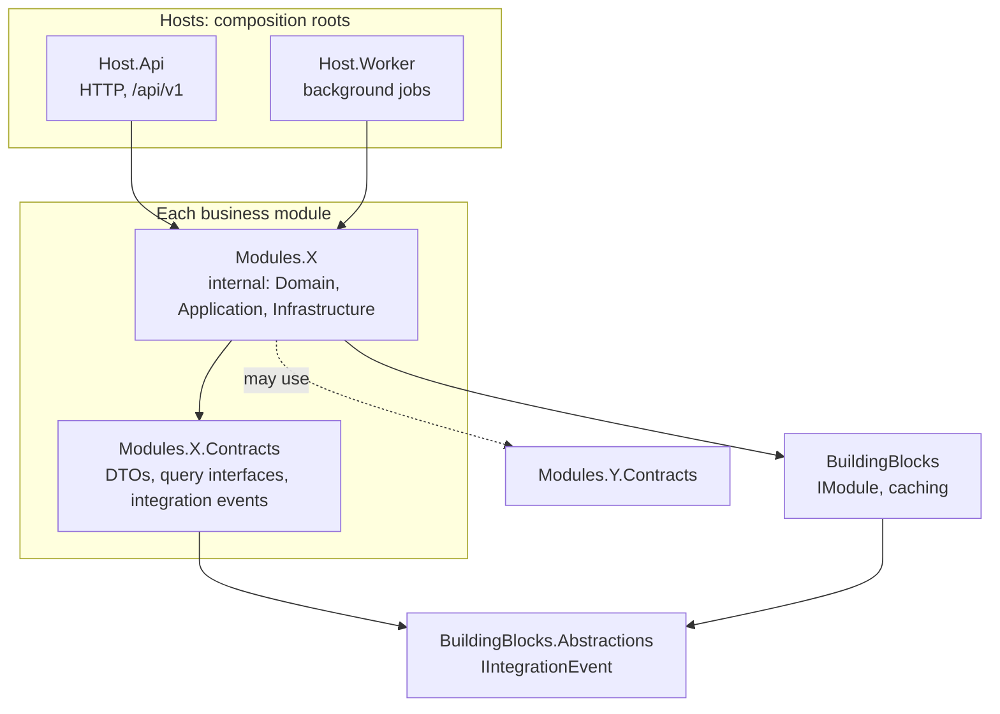
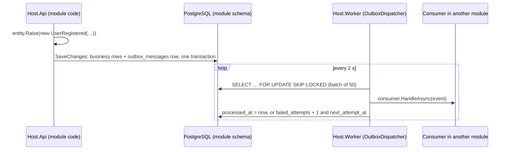

# English School

Backend for an 8-week (56-day) **A0 → A2 English course for Uzbek speakers**: daily grammar and
vocabulary, practice with tiered AI feedback, spaced-repetition review and a daily-discipline loop.

It is a **.NET 10 modular monolith**: one deployable API, one background worker, and business modules
whose boundaries are enforced by tests rather than by convention.

| | |
|---|---|
| **Status** | Dev-weeks 3–4 done: transactional outbox and the Practice grading engine. Curriculum, Identity and Practice are implemented; five modules are scaffolded with their contracts. |
| **Runtime** | .NET 10 (SDK pinned in [`global.json`](global.json)), ASP.NET Core minimal APIs |
| **Data** | PostgreSQL 18 + pgvector, EF Core 10 (Npgsql), one schema per module |
| **Cache** | HybridCache: in-process L1, Valkey 8 (Redis protocol) as shared L2 |
| **Auth** | JWT access tokens + rotating refresh tokens; email/password or Telegram Login |
| **Tests** | xUnit, ArchUnitNET, WebApplicationFactory, Testcontainers |

---

## Contents

- [Architecture](#architecture)
- [Modules](#modules)
- [Getting started](#getting-started)
- [Configuration](#configuration)
- [API](#api)
- [Authentication](#authentication)
- [Database and migrations](#database-and-migrations)
- [Testing](#testing)
- [Conventions](#conventions)
- [Troubleshooting](#troubleshooting)

---

## Architecture



**Hosts.** `Host.Api` and `Host.Worker` each list their modules in a `ModuleCatalog` and call
`IModule.AddServices`. Only the API calls `IModule.MapEndpoints`, under the `/api/v1` group. The Worker
will run the outbox dispatcher, nightly jobs and batch AI work; it has no jobs yet.

**Modules.** Every module is two projects:

- `Modules.X` holds the implementation. Its only public type is `XModule`; everything else is `internal`.
- `Modules.X.Contracts` is the module's public API: DTOs, query interfaces and integration events. It
  references only `BuildingBlocks.Abstractions`, never EF Core, ASP.NET Core or Npgsql.

**Rules** (enforced by [`tests/Architecture.Tests`](tests/Architecture.Tests), so a violation fails `dotnet test`):

1. A module never depends on another module's implementation, only on its `.Contracts`.
2. Contracts never depend on any module implementation.
3. Contracts reference no web or data frameworks.
4. A module's only public type is its `XModule` entry point (EF migrations excepted).
5. Building blocks know nothing about modules.
6. Every module's services resolve in a non-web host. Web-only services such as authorization belong
   in `Host.Api`.
7. Integration events are sealed records in `X.Contracts.Events`, never in module code, and every one
   round-trips through the outbox serializer.
8. A module whose entities raise events maps an outbox table, attaches the outbox interceptor and
   registers its outbox store. Only the Worker runs the dispatcher.

**Data ownership.** Each module owns one PostgreSQL schema (`curriculum`, `identity`, …) with its own
`__ef_migrations_history` table. No module reads another module's tables. Cross-module reads go
through a Contracts interface (for example `ICurriculumQueries`).

### Integration events and the outbox

Modules notify each other asynchronously through a **transactional outbox**, so an event is never lost
and never sent for a change that was rolled back.



1. **Raise.** An entity derives from `IntegrationEventSource` and calls `Raise(...)`. For example,
   `User` raises `UserRegistered`, and `Attempt` raises `AttemptEvaluated` plus one `ErrorDetected`
   per distinct error type.
2. **Store.** `OutboxInterceptor` turns those events into rows of the module's own `outbox_messages`
   table during `SaveChanges`, in the same transaction as the business data. A module opts in with
   `modelBuilder.AddOutboxMessages()`, `options.UseOutbox()` and `services.AddOutboxStore<TContext>()`.
3. **Deliver.** Only `Host.Worker` runs the dispatcher (`AddOutboxDispatcher`). It claims batches with
   `FOR UPDATE SKIP LOCKED`, so several Worker instances never deliver the same message twice at once.
4. **Consume.** A module subscribes with `services.AddIntegrationEventConsumer<TEvent, TConsumer>()`.
   Events nobody subscribes to are marked processed.
5. **Fail.** A failing consumer is retried with exponential backoff (2 s, 4 s, … capped at 5 min). After
   `MaxAttempts` (10) the message is parked, with `last_error` kept for inspection.

Delivery is **at least once**: a consumer may see the same event twice, so it must be idempotent. Use
`EventId` (the outbox row's primary key) as the de-duplication key. The stored type name is the event's
full CLR name, so renaming or moving an event type strands its unprocessed rows. Treat event types as a
public contract.

### Repository layout

```text
├── src
│   ├── BuildingBlocks.Abstractions/   # IIntegrationEvent, IntegrationEventSource, IIntegrationEventConsumer (framework-free)
│   ├── BuildingBlocks/                # IModule, AddHybridCaching(), Outbox/, ClaimsPrincipal.TryGetUserId()
│   ├── Host.Api/                      # web host, ModuleCatalog, appsettings
│   ├── Host.Worker/                   # background host, ModuleCatalog, outbox dispatcher
│   └── Modules/
│       ├── Curriculum/ + Curriculum.Contracts/
│       ├── Identity/   + Identity.Contracts/
│       ├── Practice/   + Practice.Contracts/
│       └── …           # Discipline, Retention, AiGateway, Speech, Analytics
├── tests
│   ├── Architecture.Tests/            # module boundaries, host composition, event and outbox rules
│   ├── Modules.Curriculum.Tests/      # seed-data integrity
│   ├── Modules.Identity.Tests/        # API + outbox integration (PostgreSQL) + unit tests
│   └── Modules.Practice.Tests/        # API integration (PostgreSQL), grading tiers, seed content
├── deploy/postgres/init/              # runs once on a fresh database (CREATE EXTENSION vector)
├── scripts/dev-secrets.sh             # copies .env values into .NET user-secrets
├── docker-compose.yml                 # PostgreSQL 18 + pgvector, Valkey 8
├── Directory.Build.props              # net10.0, nullable, warnings as errors, analyzers
└── Directory.Packages.props           # central package versions
```

---

## Modules

| Module | Status | Responsibility | Contracts today |
|---|---|---|---|
| **Curriculum** | Implemented | Course → week → day structure, grammar topics, vocabulary. Versioned, read-only content served from HybridCache. | `ICurriculumQueries` |
| **Identity** | Implemented | Sign-up and login (email + password, Telegram), JWT access tokens, rotating refresh tokens, lockout. | `UserRegistered` event (via the outbox) |
| **Practice** | Implemented (core) | Day exercises (gap-fill, multiple choice, matching), 4-tier grading, attempts, repeated-error taxonomy. | `AttemptEvaluated`, `ErrorDetected` events (via the outbox) |
| Retention | Planned: weeks 4–5 | Flashcards, Leitner then FSRS scheduling. | `CardLapsed` |
| Discipline | Planned: weeks 6–7 | Daily plan, morning review gate (≥ 80 %), session state machine, focus time. | `DailyGatePassed`, `BlockCompleted`, `SessionEnded` |
| Analytics | Planned: weeks 6–7 | Progress and weekly-report read models. | `IProgressQueries` |
| AiGateway | Planned: weeks 8–9 | The single path to LLMs: LanguageTool, Claude, evaluation cache, cost budget. | `IAiGateway` |
| Speech | Planned: week 10 | Text-to-speech files, Whisper transcription, pronunciation scoring. | `TranscriptReady` |

### Practice: exercises and grading

[`practice.v1.json`](src/Modules/Practice/Seed/practice.v1.json) holds 25 exercises for the week-1 lesson
days (1–6). Each one targets that day's grammar topic and "Diqqat" warnings. Matching pairs are copied
from the curriculum's own vocabulary for that day, and a test enforces this. Gap-fill items list their
accepted answers plus *known mistakes*, each with an error code and an Uzbek explanation of the rule.

Answers go through a **tiered pipeline**, cheapest first. The first tier that can decide wins, and the
attempt records which tier that was.

| Tier | What it does | Status |
|---|---|---|
| **0** Rules | Exact accepted answer, `AnswerPattern` regex, known mistake, chosen option, matching pairs. | ✅ |
| **1** Normalization | Letter case, spacing, curly or Uzbek `ʼ` apostrophes, contractions (`isn't` = `is not`), then typo detection: a missing apostrophe or 1–2 letter edits counts as *partially correct* with a `SPELLING` hint. Swaps of grammar words (`these`/`those`) are never treated as typos. | ✅ |
| **2–3** AiGateway | Gap-fill answers the rules couldn't decide are sent to `IAiGateway` (Haiku, then Opus). The tier switches itself on as soon as an `IAiGateway` is registered. | Week 8 |

If no tier decides, the answer is marked incorrect and the correct answer is shown, without guessing an
error type. Known error codes (`BE_FORM`, `ART_WRONG`, `PLURAL_FORM`, …; see
[`ErrorCodes`](src/Modules/Practice/Domain/ErrorCodes.cs)) increment the student's `user_errors`
counter and are published as `ErrorDetected`.

**Curriculum content.** [`curriculum.v1.json`](src/Modules/Curriculum/Seed/curriculum.v1.json) is
embedded in the assembly: 56 days over 8 weeks, with 48 lessons, 6 review days and exams on day 28
(A1 gate) and day 56 (A2 gate). It holds 1,117 words and 235 phrases. Textbooks are referenced by unit
code only (`EVU:14`, `DEST:36`); no book text is stored. **Content is immutable per version.** Once a
version is seeded anywhere, a change means a new `curriculum.vN.json` and a new `ActiveCourseVersion`,
because the seeder skips versions that already exist.

---

## Getting started

### Prerequisites

- .NET SDK **10.0.112** or a later 10.0 feature band
- Docker or Podman, with Compose v2
- `openssl` (used to generate local secrets)

### 1. Start PostgreSQL and Valkey

```bash
cp .env.example .env
# Set a real password (hex avoids characters that need escaping):
sed -i "s/^POSTGRES_PASSWORD=.*/POSTGRES_PASSWORD=$(openssl rand -hex 24)/" .env

docker compose up -d          # Podman: works through podman-docker, or use `podman compose up -d`
docker compose ps             # both services should report (healthy)
```

PostgreSQL listens on **127.0.0.1:5434** (5432 often belongs to a locally installed PostgreSQL) and
Valkey on **127.0.0.1:6379**. Both ports are bound to localhost only.

### 2. Store local secrets

```bash
scripts/dev-secrets.sh
```

The script copies the connection string from `.env` into .NET user-secrets for both hosts and creates a
JWT signing key for `Host.Api` if one doesn't exist yet. Passwords and keys stay out of the repository:
`appsettings.Development.json` holds a connection string *without* a password. Re-running the script is
safe; an existing JWT key is kept, so issued tokens stay valid.

### 3. Run

```bash
dotnet tool restore                      # dotnet-ef, pinned in dotnet-tools.json
dotnet run --project src/Host.Api        # http://localhost:5080
dotnet run --project src/Host.Worker     # optional; no jobs yet
```

In Development, the API applies both modules' migrations and seeds curriculum v1 on startup. Expect
`Curriculum v1 seed qilindi: 56 kun, 1117 soʻz, 235 ibora.` in the log on the first run.

### 4. Try it

```bash
curl -s localhost:5080/health                         # Healthy
curl -s localhost:5080/api/v1/curriculum/days/1

curl -s localhost:5080/api/v1/identity/register -H 'Content-Type: application/json' \
  -d '{"email":"ali@example.com","password":"correct-horse-battery","displayName":"Ali Valiyev"}'
# → 201 with accessToken + refreshToken

curl -s localhost:5080/api/v1/identity/me -H "Authorization: Bearer <accessToken>"
```

---

## Configuration

Settings come from `appsettings.json`, then `appsettings.{Environment}.json`, then user-secrets
(Development only), then environment variables. In environment variables, `:` becomes `__`, so
`Identity:Jwt:SigningKey` is `Identity__Jwt__SigningKey`.

| Key | Default | Notes |
|---|---|---|
| `ConnectionStrings:Postgres` | *(empty)* | **Secret.** Locally from user-secrets; set in every deployed environment. |
| `ConnectionStrings:Redis` | *(empty)* | Optional. When set, Valkey/Redis becomes the HybridCache L2 for both hosts (key prefix `es:`). |
| `Curriculum:ActiveCourseVersion` | `1` | Course version served by the API. |
| `Curriculum:ApplyMigrationsOnStartup` / `SeedOnStartup` | `false` | `true` only in the API's Development config. |
| `Identity:ApplyMigrationsOnStartup` | `false` | `true` only in the API's Development config. |
| `Identity:DefaultTimeZone` | `Asia/Tashkent` | IANA ID, used when sign-up doesn't provide one (always the case for Telegram). |
| `Identity:MaxFailedLoginAttempts` / `LockoutDuration` | `5` / `00:05:00` | Consecutive failures before a temporary lockout. |
| `Identity:Jwt:SigningKey` | *(empty)* | **Secret, API only.** At least 32 bytes. The API refuses to start without it; the Worker doesn't need it. |
| `Identity:Jwt:Issuer` / `Audience` | `english-school` | |
| `Identity:Jwt:AccessTokenLifetime` / `RefreshTokenLifetime` | `00:15:00` / `30.00:00:00` | |
| `Identity:Telegram:BotToken` | *(empty)* | **Secret.** From @BotFather. While empty, `/identity/telegram` returns 503. |
| `Identity:Telegram:MaxAuthAge` | `00:10:00` | Older signed widget data is rejected (replay protection). |
| `Practice:ActiveCourseVersion` | `1` | Keep it equal to `Curriculum:ActiveCourseVersion`. |
| `Practice:ApplyMigrationsOnStartup` / `SeedOnStartup` | `false` | `true` only in the API's Development config. |
| `Outbox:PollingInterval` / `BatchSize` / `MaxAttempts` | `00:00:02` / `50` / `10` | Worker only. |

### Production checklist

- Supply secrets through environment variables or a secret store, never through appsettings files:
  `ConnectionStrings__Postgres`, `ConnectionStrings__Redis`, `Identity__Jwt__SigningKey`, and
  `Identity__Telegram__BotToken` if Telegram login is enabled.
- Leave the `ApplyMigrationsOnStartup` and `SeedOnStartup` flags `false`, and run migrations as a
  separate deployment step (see [migrations](#database-and-migrations)).
- The runtime image needs **tzdata**: time zones are validated at startup and on sign-up. The
  Debian-based `mcr.microsoft.com/dotnet/aspnet` images include it; chiseled images need the `-extra` variant.
- Terminate TLS in front of the API. Tokens are bearer credentials.

---

## API

All business endpoints live under `/api/v1`. Errors are [RFC 9457](https://www.rfc-editor.org/rfc/rfc9457)
ProblemDetails; `detail` messages are in Uzbek and suitable to show to users. Validation errors (400)
list the failing fields under `errors` with camelCase keys.

| Method | Path | Auth | Responses |
|---|---|---|---|
| GET | `/` | – | Service name and loaded modules |
| GET | `/health` | – | `Healthy` when the `curriculum-db`, `identity-db` and `practice-db` checks pass |
| GET | `/api/v1/curriculum/days` | – | 200: summary of all 56 days |
| GET | `/api/v1/curriculum/days/{n}` | – | 200: day with grammar and vocabulary · 404 |
| POST | `/api/v1/identity/register` | – | 201 + tokens (`Location: …/identity/me`) · 400 · 409 email taken |
| POST | `/api/v1/identity/login` | – | 200 + tokens · 401 · 429 locked out |
| POST | `/api/v1/identity/telegram` | – | 201 new account · 200 existing · 401 bad signature · 503 not configured |
| POST | `/api/v1/identity/refresh` | – | 200 + rotated tokens · 401 |
| POST | `/api/v1/identity/logout` | – | 204 (also for unknown tokens) |
| GET | `/api/v1/identity/me` | Bearer | 200 profile · 401 |
| GET | `/api/v1/practice/days/{n}/exercises` | Bearer | 200 exercises, answers hidden (empty for review and exam days) · 404 day not in course |
| POST | `/api/v1/practice/attempts` | Bearer | 200 verdict, score, tier and feedback · 400 · 404 unknown exercise |

<details>
<summary>Request and response shapes</summary>

```jsonc
// POST /identity/register   (timeZone is optional, IANA ID)
{ "email": "ali@example.com", "password": "8–128 chars", "displayName": "Ali Valiyev", "timeZone": "Asia/Samarkand" }

// POST /identity/login
{ "email": "ali@example.com", "password": "…" }

// POST /identity/refresh  and  POST /identity/logout
{ "refreshToken": "…" }

// POST /identity/telegram: forward the Telegram Login Widget user object unchanged
{ "id": 123456789, "first_name": "Ali", "last_name": "Valiyev", "username": "ali", "photo_url": "…", "auth_date": 1760000000, "hash": "…" }

// Token response (register, login, telegram, refresh)
{ "userId": "…", "accessToken": "…", "accessTokenExpiresAt": "…", "refreshToken": "…", "refreshTokenExpiresAt": "…" }

// GET /practice/days/2/exercises: choices and matchTargets come sorted alphabetically, so their order never reveals the answer
[{ "id": "…", "position": 3, "type": "MultipleChoice", "instruction": "Toʻgʻri tarjimani tanlang.", "prompt": "«U (qiz) charchagan.»",
   "choices": [{ "id": "…", "text": "She am tired." }, …], "matchTargets": [] }]

// POST /practice/attempts: send the field that matches the exercise type
{ "exerciseId": "…", "answer": "is", "timeTakenMs": 5200 }                       // GapFill
{ "exerciseId": "…", "selectedOptionId": "…", "timeTakenMs": 5200 }             // MultipleChoice
{ "exerciseId": "…", "matches": [{ "optionId": "…", "matchText": "xursand" }, …], "timeTakenMs": 30000 } // Matching

// Attempt result
{ "attemptId": "…", "verdict": "Incorrect", "score": 0, "evaluationTier": 0,
  "feedback": [{ "errorCode": "BE_FORM", "correction": "am", "explanation": "I bilan faqat am ishlatiladi: I am a student." }] }
```

</details>

---

## Authentication

**Access tokens** are HS256 JWTs, valid for 15 minutes. They carry `sub` (user ID), `name` and `jti`.
They are stateless and never stored.

**Refresh tokens** are 256-bit random values, valid for 30 days.

- **Storage:** only their SHA-256 hash is stored.
- **Rotation:** every refresh issues a new token and revokes the old one. All tokens from one login
  form a *family*, which is a single session.
- **Reuse detection:** if an already-rotated token is presented again, the token may have been stolen,
  so the whole family is revoked and that device must log in again. Other sessions are unaffected.
- **One redemption per token:** the token row is locked during refresh, so even two simultaneous
  requests can redeem a token only once. The second request counts as reuse. **Clients must serialize
  refresh calls** (for example, one in-flight refresh shared by all requests).
- **Logout:** revokes the session's whole family.

**Passwords** are hashed with ASP.NET Core Identity's `PasswordHasher` (PBKDF2, salted, versioned
format) and transparently re-hashed when the format is upgraded.

- **Lockout:** after 5 consecutive failures, the account is locked for 5 minutes. The credentials row is
  locked during the check, so parallel guesses are all counted.
- **No account enumeration on login:** an unknown email gets the same 401, after the same hashing work,
  as a wrong password. (Registration does reveal a taken email with 409.)

**Telegram login** accepts only data signed by Telegram's
[Login Widget](https://core.telegram.org/widgets/login): `hash = HMAC-SHA256(data_check_string, SHA256(bot_token))`.
Signed data older than 10 minutes is rejected. A bare Telegram ID is never trusted.

**Protecting endpoints in other modules:** add `.RequireAuthorization()` to the endpoint and read the
user ID from the `sub` claim. Inbound claim mapping is off, so the claim keeps that name.

Not built yet: email verification, password reset, linking Telegram to an existing email account,
and rate limiting at the edge.

---

## Database and migrations

Each module has its own `DbContext`, so `--context` is required.

```bash
# Add a migration
dotnet ef migrations add <Name> --project src/Modules/Identity --startup-project src/Host.Api \
  --context IdentityDbContext --output-dir Infrastructure/Migrations

# Check that the model and the latest migration agree (run in CI)
dotnet ef migrations has-pending-model-changes --project src/Modules/Curriculum --startup-project src/Host.Api --context CurriculumDbContext
dotnet ef migrations has-pending-model-changes --project src/Modules/Identity --startup-project src/Host.Api --context IdentityDbContext
dotnet ef migrations has-pending-model-changes --project src/Modules/Practice --startup-project src/Host.Api --context PracticeDbContext

# Production: an idempotent SQL script per module (or `dotnet ef migrations bundle`)
dotnet ef migrations script --idempotent --project src/Modules/Identity --startup-project src/Host.Api \
  --context IdentityDbContext -o identity.sql
```

| Schema | Tables |
|---|---|
| `curriculum` | `days`, `grammar_topics`, `vocabulary_items` |
| `identity` | `users`, `user_credentials`, `refresh_tokens`, `outbox_messages` |
| `practice` | `exercises`, `exercise_options`, `attempts`, `user_errors`, `outbox_messages` |

Column and table names are snake_case (EFCore.NamingConventions). `practice.attempts.user_id` has no
foreign key to `identity.users`, by design: modules stay separate in the database too.

---

## Testing

```bash
dotnet test                                            # everything (Docker or Podman required)
dotnet test --filter "FullyQualifiedName!~.Tests.Api." # skip DB-backed tests: no Docker needed
```

| Project | What it covers |
|---|---|
| `Architecture.Tests` | Module-boundary rules and host composition (every module's services resolve in the Worker with build-time validation; only the Worker runs the dispatcher). Event conventions and an outbox round trip for every contract event; outbox wiring for every module that raises events. |
| `Modules.Curriculum.Tests` | Seed integrity: 56-day calendar, review and exam days, vocabulary totals, unique words, Uzbek `ʻ` and English `'` apostrophes, entity mapping. |
| `Modules.Identity.Tests` | **Api/**: the real API host via `WebApplicationFactory`, against PostgreSQL in a throwaway container. Covers sign-up, validation, login, lockout (including parallel guesses), forged tokens, refresh rotation, reuse detection, concurrent refresh, logout and Telegram, plus the outbox end to end: `UserRegistered` written atomically, delivered by a Worker-style dispatcher, and retried with backoff then parked. **Domain/** and **Security/**: lockout and rotation rules and the Telegram signature check, with no I/O. |
| `Modules.Practice.Tests` | **Api/**: exercises (order, hidden answers, 404, auth), grading at each tier, per-student error counting, attempts and events in one transaction, rejected submissions. **Grading/**: each tier and the pipeline, including the AiGateway handoff via a fake `IAiGateway`. **Seed/**: every authored answer is graded through the real pipeline, and matching pairs must equal the curriculum's words. |

Integration tests use the same `pgvector/pgvector:pg18` image as Compose. The test host runs in the
`Testing` environment, so your Development settings and user-secrets are never loaded.

**Podman.** Point Testcontainers at the user socket, and disable Ryuk, its cleanup sidecar, which
can't run on rootless Podman. The tests remove their own container either way.

```bash
export DOCKER_HOST=unix://$XDG_RUNTIME_DIR/podman/podman.sock
export TESTCONTAINERS_RYUK_DISABLED=true
```

---

## Conventions

- **Build:** `net10.0`, nullable enabled, **warnings as errors**, `AnalysisLevel=latest-recommended`.
  Package versions live only in `Directory.Packages.props`.
- **Naming:** project `Modules.X` builds to assembly and root namespace `EnglishSchool.Modules.X`.
  `InternalsVisibleTo` exposes internals to the matching test project only.
- **Language:** code identifiers and test names are English. Comments, log messages and user-facing
  error messages are Uzbek (Latin), written with `ʻ` (U+02BB) in *oʻ / gʻ* and `ʼ` (U+02BC) for the
  tutuq belgisi (*maʼlumot*). English text inside Uzbek strings keeps the ASCII apostrophe (`can't`).
- **Tests:** test names describe behaviour in sentence form (`Login_locks_…`). Integration tests share
  one container and isolate themselves with unique emails or Telegram IDs.

### Adding a module

1. Create `src/Modules/X` and `src/Modules/X.Contracts`, copying an existing module's `.csproj` files.
2. Implement `XModule : IModule` as the only public type. Use a schema named after the module, with its
   own migrations history table.
3. Register the module in both `ModuleCatalog.cs` files and in
   [`tests/Architecture.Tests/SolutionModules.cs`](tests/Architecture.Tests/SolutionModules.cs), and
   reference it from `Architecture.Tests.csproj`. Add the projects to `EnglishSchool.slnx`.
4. Put web-only registrations (authorization policies, routing) in `Host.Api`, not in `AddServices`.
5. If the module raises events, declare them as sealed records in `X.Contracts/Events` and wire the
   outbox (see [Integration events and the outbox](#integration-events-and-the-outbox)). The architecture
   tests fail until all three outbox pieces are in place.

---

## Troubleshooting

| Symptom | Cause and fix |
|---|---|
| `docker compose up` fails: address already in use | Another PostgreSQL holds the port. Change `POSTGRES_PORT` in `.env`, update both `appsettings.Development.json` files, then re-run `scripts/dev-secrets.sh`. |
| API exits with `Identity:Jwt:SigningKey kamida 32 bayt…` | No signing key is configured. Run `scripts/dev-secrets.sh`, or set `Identity__Jwt__SigningKey`. |
| `password authentication failed for user "english_school"` | user-secrets and `.env` disagree: re-run the script. If the volume was created with an older password, PostgreSQL keeps that one; `docker compose down -v` recreates the database but **deletes all local data**. |
| First start logs `Failed executing DbCommand … __ef_migrations_history` | Harmless: EF checks for the history table before creating it on a fresh database. |
| Integration tests fail with `DockerContainerNotFoundException` (Ryuk) | Podman: set the two environment variables in [Testing](#testing). |
| Rows pile up in `*.outbox_messages` with `processed_at` empty | The Worker isn't running (only it dispatches events). Start `src/Host.Worker`. Rows with `failed_attempts` at the limit are parked; read `last_error`. |
